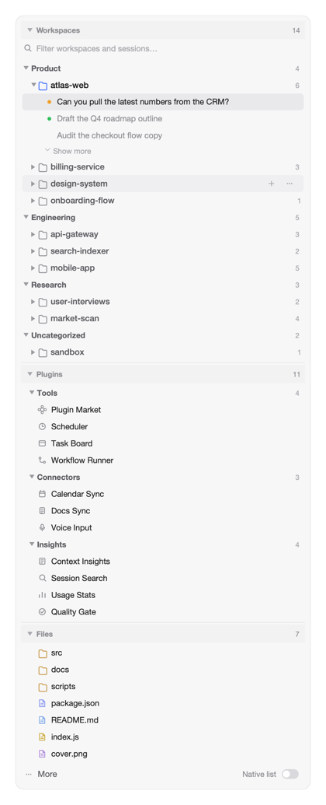

# dsh-sidebar-cards

Turns the DeepSeek Harness left sidebar into cards: workspace and session management,
plugin management, and project file management — all in one column.



*Card view — an illustration with invented workspaces and plugins.*

## Install

```sh
# from GitHub
dsh plugin --profile web add github:weixiaolv/dsh-sidebar-cards

# or from npm
dsh plugin --profile web add dsh-sidebar-cards
```

Then add the bundle to the profile's `dsh.profile.bundles` list (or enable it on the
Plugins page) and restart `dsh web`. Requires DSH `0.2.1-rc.3` or newer; checked on
`0.2.2-rc.1`.

## What you get

- **Workspaces** — your projects in categories you create, with the session actions you
  expect: rename, pin, fork, archive, and a native context menu on every row.
- **Plugins** — every panel and shortcut entry in one place, grouped however you like,
  hidden when you do not need them.
- **Files** — the current project's tree, one level at a time, with copy and open actions.
- **One switch** at the bottom right flips between these cards and the shipped sidebar at
  any time. Everything is reversible: the brand row, the new-session button and the settings
  entry stay native, and switching back leaves no trace.
- **Resizable cards** — drag the divider between two cards to give one more room; a
  double click hands the height back to the layout. Sizes are remembered.
- Follows your DSH theme — light and dark need no separate configuration.

## Capabilities

| Card | What it does |
| --- | --- |
| Workspaces | Create / rename / delete / collapse categories; drag workspaces between them, rename, delete, start a session in one; open, rename, pin, fork or archive sessions (archiving a running session asks first), copy the session id; five sessions per workspace by default, with "show more" adding ten at a time; the open session and the workspace that holds it are marked |
| Workspaces, view options | Three-way archived filter; sort workspaces by name or by their latest session, each in either direction (re-picking the active mode flips it); expand or collapse everything |
| Search | Matches a workspace's own title and path, and also keeps a workspace whose sessions match; matched counts show on each row, and an "expand all hits" switch unfolds the results without changing your saved fold state |
| Language | Every label ships in nine languages: English, Simplified and Traditional Chinese, Japanese, French, German, Spanish, Portuguese and Russian. The default follows the browser — zh-CN/SG to Simplified, zh-TW/HK/MO to Traditional, ja/fr/de/es/pt/ru to their own, anything else to English. The choice lives in the Workspaces card's view options, next to “follow browser” |
| Plugins | Collects every panel and shortcut entry; your own groups, drag to regroup, hide / restore, click to open; its menu also opens the plugin list and starts a Creator session with a sidebar-plugin draft; collapsed by default |
| Files | The current project's tree, root taken from the session you are looking at. Folders load on demand and sort before files, each file with a type-coloured icon. A click selects a file and opens its preview; ⌘/Ctrl-click toggles and Shift-click extends the selection. The header copies the selected paths; the options menu offers reveal in Finder / File Explorer, open with the system default (labelled with the application's own name and icon when the system reports them), copy file paths or the project path, and expand / collapse all |

## Settings

Everything you change — categories, groups, fold state, sorting, language — is saved in
`~/.dsh/sidebar-cards/state.json` and comes back on every start, in any browser. Deleting
that file restores the defaults.

## Known limitations

- Collapsing the native rows relies on the shell's own style hooks. If a DSH upgrade
  renames them, those native rows simply reappear; nothing breaks.
- Overlaps `dsh-workspace-categories` and `dsh-panel-control`; keep only one of them.
