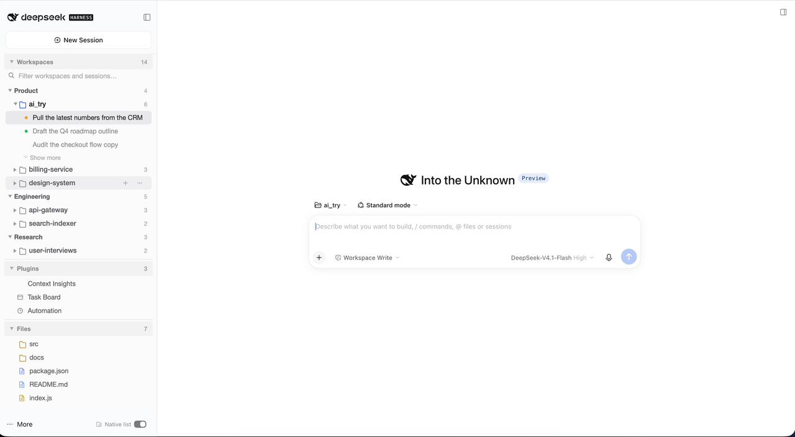

# dsh-sidebar-cards

把 DeepSeek Harness 的左栏变成卡片式：工作区与会话管理、插件管理、项目文件管理，都收在同一列里。

[English](README.md) · **简体中文**



*卡片式侧栏实际效果 —— 图中工作区、插件、文件均为虚构内容。*

## 安装

```sh
# 从 GitHub 安装
dsh plugin --profile web add github:weixiaolv/dsh-sidebar-cards

# 或从 npm 安装
dsh plugin --profile web add dsh-sidebar-cards
```

然后把该 bundle 加入 profile 的 `dsh.profile.bundles` 列表（或在「插件」页启用），并重启 `dsh web`。
要求 DSH `0.2.1-rc.3` 及以上；已在 `0.2.2-rc.1` 上验证。

## 你会得到什么

- **工作区** — 你的项目按自建分类排列，保留熟悉的会话操作：重命名、置顶、分叉、归档，每行都有原生右键菜单。
- **插件** — 所有面板与快捷入口集中在一处，可按你的方式分组，不需要时折叠隐藏。
- **项目文件** — 当前项目的文件树，逐层展开，支持复制路径与打开操作。
- **一个开关** 在右下角，随时在卡片侧栏与原生侧栏之间切换。完全可逆：品牌行、新建会话按钮和设置入口保持原生，切回后不留痕迹。
- **卡片可调高度** — 拖动两张卡之间的分隔条给某一侧更多空间；双击分隔条把高度交还给布局。尺寸会被记住。
- 跟随 DSH 主题 —— 明暗色无需单独配置。

## 能力

| 卡片 | 说明 |
| --- | --- |
| 工作区 | 新建 / 重命名 / 删除 / 折叠分类；在工作区之间拖拽归类、重命名、删除、在其中新建会话；会话可打开、重命名、置顶、分叉、归档（归档运行中的会话会先询问）、复制会话 ID；每个工作区默认显示 5 个会话，"显示更多"每次再加 10 个；当前打开的会话及其所属工作区会被标记 |
| 工作区 · 视图选项 | 归档状态三态筛选；按名称或按最近会话排序工作区，每种都支持两个方向（重复点击当前模式即反向）；一键全部展开或折叠 |
| 搜索 | 同时匹配工作区自身的标题与路径，并保留"会话命中"的工作区；每行显示命中数量，"展开全部命中"开关可在不改变你已保存折叠状态的前提下展开结果 |
| 语言 | 所有文案内置九种语言：英语、简体中文、繁体中文、日语、法语、德语、西班牙语、葡萄牙语、俄语。默认跟随浏览器 —— zh-CN/SG 用简体，zh-TW/HK/MO 用繁体，ja/fr/de/es/pt/ru 用各自语言，其余用英语。入口在工作区卡的视图选项里：「界面语言」一行显示当前语言，点开后在旁边列出「跟随浏览器」和九种语言 |
| 插件 | 汇集所有面板与快捷入口；可自建分组、拖拽重新归类、隐藏 / 恢复、点击打开；菜单里还能打开插件列表，并新建一个带侧栏插件草稿的 Creator 会话；默认折叠 |
| 项目文件 | 当前项目的文件树，根目录取自你正在看的会话。目录按需加载并排在文件前，每个文件有按类型着色的图标。单击选中文件并打开预览；⌘/Ctrl 单击切换选中，Shift 单击扩展选区。头部按钮复制选中路径；选项菜单提供在访达 / 资源管理器中显示、用系统默认应用打开（系统能提供时标注应用名与图标）、复制文件路径或项目路径、全部展开 / 全部折叠 |

## 设置

你改动的一切 —— 分类、分组、折叠状态、排序、语言 —— 都保存在
`~/.dsh/sidebar-cards/state.json`，任意浏览器每次启动都会恢复。删除该文件即恢复默认。

## 已知限制

- 隐藏原生行依赖 shell 自身的样式钩子。如果 DSH 升级后改了这些类名，原生行会重新出现，但不会出错。
- 与 `dsh-workspace-categories`、`dsh-panel-control` 功能重叠，请只保留其中一个。
